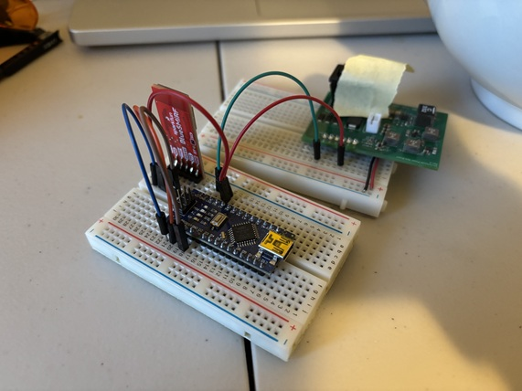
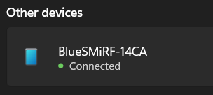
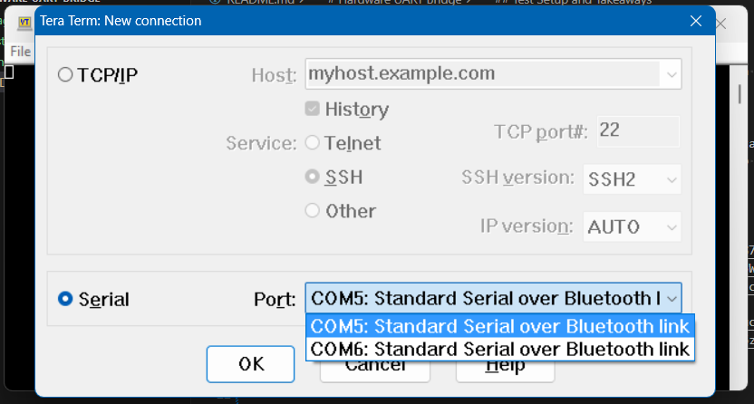
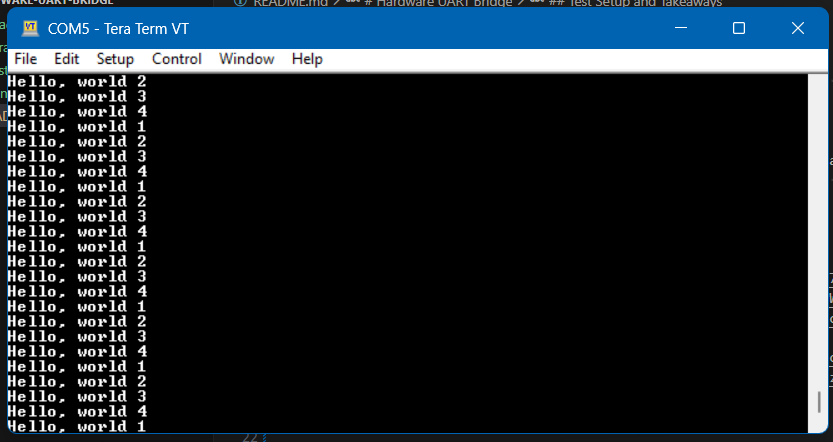
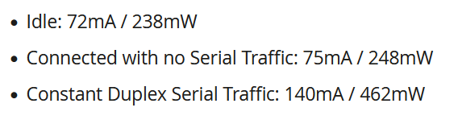

# Hardware UART Bridge

- Hardware reference files for the UART Bridge for Mouse Unit 07
- ...Original thought was to use the ESP32-PICO-MINI-02 IC to make a custom board, but SparkFun's BlueSMiRF module does exactly what we need to do

## ESP32-PICO-MINI-02

- Espressif's tiny ESP32 module for bluetooth and other minor applications
- It's made to transmit UART serial over bluetooth for a computer to pick up over a terminal emulator

## Reference Links

- **SparkFun's BlueSMiRF Module**:
  - SparkFun dev board for SPP: https://www.sparkfun.com/products/23287
  - How-to-use video by SparkFun: https://www.youtube.com/watch?v=i8u3W0jVFTw
  - USB to serial breakout to program the ESP32: https://www.sparkfun.com/products/15096
- **Supplement Links**:
  - Sparkfun dev board for generic use: https://www.sparkfun.com/products/23386
  - Video of ES32-S3 basic setup: https://youtu.be/tQ0dL_9M1wI?si=PeC6zGlJdLPajcbK

## Test Setup

- 
 - The only hardware setup the module needs is:
   - +5V supply on "3V3-5V" pin
   - RX and TX from some device on "TX" and "RX" pns respectively
   - GND on "GND" pin
  - When the module is discoverable, you should see the green LED blink
- 
  - To connect to the device, you just look for BlueSMiRF under bluetooth devices and connect to it
- 
- 
  - After your computer is connected to the module, you should see bluetooth options when you choose connection over serial
    - There are 2 windows- one for outgoing (device requests connection to module) and incoming (module requests connection to computer)
    - Only the outgoing window is used- should be the first of the two windows
  - That's it!

## Takeaways

- 3V3 isn't enough
  - 3V3 on the Arduino Nano wasn't enough to power the module, so 5V is the way to go
- Losing connection
  - If the module loses power while a connection is running, you need to restart the TeraTerm window (and reconnect to the bluetooth device)
- Baud rate
  - 115200 from the Arduino Nano to the module w/ TeraTerm set up for 115200 baud rate works well
  - ...Baud rate isn't an applicable concept when a virtual serial port is created w/ bluetooth, but baud rate from the Arduino to the module does matter
- Other serial settings
  - All serial settings can follow TeraTerm default settings
- Current draw
  - 
  - 140mA max
- What to do for micromouse
  - Provide connections for +5V, RX/TX, GND over a 6 pin 2.54mm pitch TH connector and we're good to go